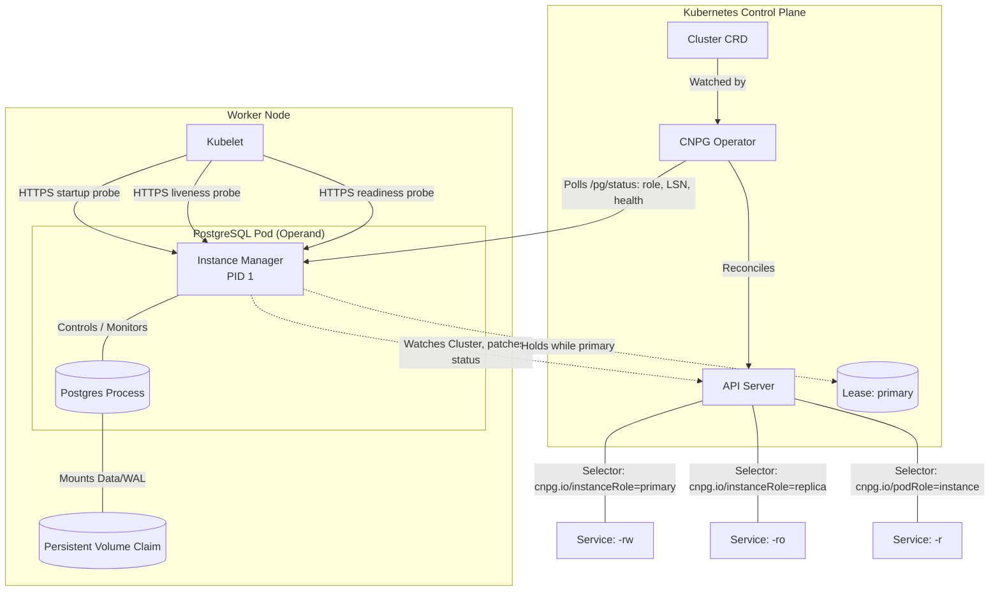
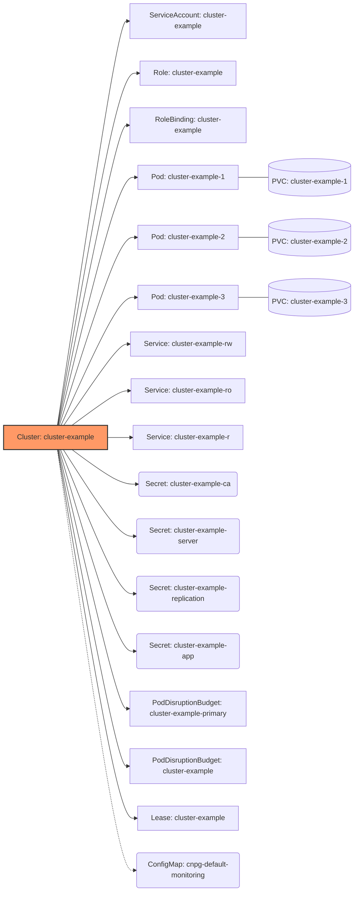
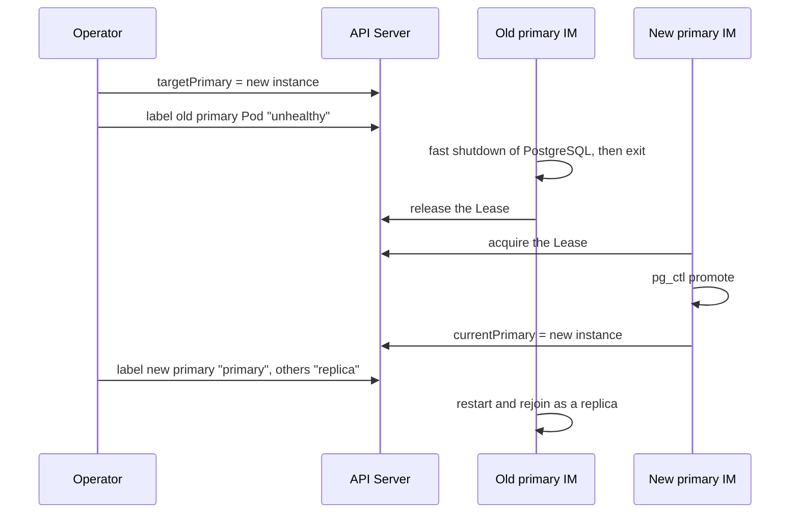

# CloudNativePG Architecture

> [!TIP]
> **Source Code Navigation:** The [`Cluster`](../api/v1/cluster_types.go)
> resource is the primary and most important Custom Resource Definition (CRD)
> provided by CloudNativePG. For a detailed mapping of the architectural
> components to their implementation, please see the
> [Source Code Reference](#source-code-reference) at the bottom of this page.

This document describes the design architecture of CloudNativePG, providing the
technical foundation for contributors and auditors to understand how the
operator ensures high availability and security for PostgreSQL workloads.
It focuses on core lifecycle and reconciliation, including the declarative
management of objects that live inside PostgreSQL; topics such as WAL
archiving, backup/restore pipelines, the plugin system, and webhook admission
controllers are outside its current scope.

## Design Philosophy

CloudNativePG follows the "Cloud Native" paradigm. Unlike PostgreSQL solutions
that delegate failover and replication management to additional components
(like Patroni, repmgr, or Stolon), CloudNativePG relies on the **Kubernetes
API** as the single source of truth.

### Key Principles

- **No Sidecars:** Management logic is integrated into the `postgres` container
  as an **Instance Manager (PID 1)**. The operator injects no sidecar of its
  own; only [CNPG-I plugins](../docs/src/cnpg_i.md) can add one.
- **Direct Pod Management:** Does **not** use `StatefulSets`, allowing for more
  granular control over individual instances.
- **Native Integration:** Leverages Kubernetes primitives (Pods, PVCs,
  Services, ConfigMaps, Secrets, Leases, StorageClasses, VolumeSnapshots) for
  all database cluster operations.
- **Security by Design:** Minimal attack surface by reducing the number of
  moving parts and using non-root, immutable application containers.

## Architectural Actors

The following diagram illustrates how the [`Cluster`](../api/v1/cluster_types.go)
resource orchestrates a PostgreSQL cluster in the Kubernetes ecosystem:

## Key Differentiator: Beyond StatefulSets

A core architectural distinction of CloudNativePG is that it does not use
`StatefulSets`. By managing `Pod` and `PVC` resources directly, the Operator
gains surgical control over the cluster state.

### 1. Granular Failover and Promotion

`StatefulSets` are bound by ordinal logic (0, 1, 2). CloudNativePG can promote
any replica based on the **Log Sequence Number (LSN)** that the Operator
collects from each Instance Manager, ensuring the most up-to-date instance is
always chosen as the new primary, regardless of its name or index. The chosen
instance promotes only once it holds the primary `Lease`, which the previous
primary must release or let expire (see
[Safe primary election](../docs/src/failover.md#safe-primary-election)).

### 2. Managing "Sensitive" Parameters

In PostgreSQL, certain parameters (e.g., `max_connections`,
`max_prepared_transactions`, `max_wal_senders`) must be equal to or greater
on a standby than they are on the primary. If a standby starts with a lower
value, it will refuse to start or follow the primary.

Because CloudNativePG manages Pods directly, it can coordinate the update of
these parameters across the cluster in the correct order, ensuring that
standbys are always compatible with the primary during rolling updates or
configuration changes.

### 3. Synchronous Replication Control

`synchronous_standby_names` is managed dynamically: the Operator records the
instances and their health in the `Cluster` status, and the Instance Manager of
the primary derives the setting from that status and writes it into the
PostgreSQL configuration. Users configure this via the declarative
`synchronous` section, which supports priority-based (`first`) and
quorum-based (`any`) methods, and a `dataDurability` of `required` (strict
durability: commits wait for `number` standbys even while some are down) or
`preferred` (availability-first: only healthy replicas are listed, and
`number` is capped to how many there are).

## The Role of the Instance Manager (PID 1)

The Instance Manager is a Go binary that acts as the entry point for the
container. Its responsibilities include:

- **Postgres Lifecycle:** Starting the database with the configuration it
  generates from the `Cluster`, restarting it when that configuration requires
  it, and managing clean shutdowns. The data directory is prepared beforehand
  by the same binary, in an init container (see
  [Bootstrap Phase](#1-bootstrap-phase-init-containers)).
- **Self-Healing:** Participating in failover by executing `pg_ctl promote`
  when the Operator sets its Pod as `status.targetPrimary`, once it holds the
  primary `Lease`, and then recording itself as `status.currentPrimary`.
- **Status Reporting:** Serving the instance status (role, timeline, LSNs,
  replication state) at `/pg/status` on its HTTPS port, which the Operator
  polls on every instance; the `Cluster` status does not carry the LSNs.
- **Primary Lease:** Renewing the `Lease` while primary, and stopping
  PostgreSQL when it cannot renew it and has also lost contact with at least
  one other instance (see
  [Primary Isolation](../docs/src/instance_manager.md#primary-isolation)).
- **Declarative Object Reconciliation:** Running its own `controller-runtime`
  manager to apply the CRDs that describe objects *inside* PostgreSQL, as
  described in
  [Declarative Objects Inside PostgreSQL](#declarative-objects-inside-postgresql).

## Intelligent Probes

The Instance Manager provides a database-aware HTTPS server for Kubelet probes
(details in the [instance manager](../docs/src/instance_manager.md)
documentation):

- **Startup Probe:** Uses `pg_isready` by default, and treats a server that is
  alive but still rejecting connections as started, so that crash recovery or
  WAL replay does not get the container restarted. It also succeeds while
  `pg_rewind` runs or the Instance Manager is restarting or fencing PostgreSQL.
  Bootstrap (`initdb`, restore, cloning) is not covered: it completes in an
  init container before this container starts.
- **Liveness Probe:** Fails when the primary lease loop stops attempting lock
  operations, or when PostgreSQL ignores an immediate shutdown for longer than
  `.spec.immediateShutdownTimeout`. The lease check only applies once the
  instance has held the lease. Primary isolation fencing lives in the
  primary lease (`internal/cmd/manager/instance/run/lease`), not here.
- **Readiness Probe:** Uses `pg_isready` by default, on the primary and on the
  replicas alike, so a lagging replica stays ready. The `streaming` strategy
  (`.spec.probes.readiness.type`) also requires a replica to be streaming and,
  with `maximumLag`, to be within that lag.

## Instance Manager Endpoints

The Instance Manager listens on three ports. The status server uses TLS 1.3
with the cluster's server certificate, and accepts but does not require a
client certificate, so that the kubelet can reach the probes:

| Port | Endpoints | Callers | Authentication |
| --- | --- | --- | --- |
| `8000` (HTTPS) | `/healthz`, `/readyz`, `/startupz` | Kubelet | None |
| `8000` (HTTPS) | `/pg/status`, `/failsafe` | Operator, `kubectl cnpg status` through the API server proxy | None |
| `8000` (HTTPS) | `/pg/mode/backup`, `/pg/controldata`, `/pg/archive/partial`, `/update` | Operator | Client certificate whose public key fingerprint matches `status.operatorCertificateFingerprint` |
| `8010` (HTTP, `localhost` only) | `/pg/backup`, `/cache/`, `/cluster/status/condition/wal/archive` | `manager` subcommands inside the Pod, such as `manager backup` and WAL archiving | None |
| `9187` (HTTP, or HTTPS with `.spec.monitoring.tls.enabled`) | `/metrics` | Prometheus | None |

## Cluster Lifecycle: Orchestrated Resources

When a `Cluster` is created, the Operator generates several native objects to
manage the identity, security, and connectivity of the instances.

### 1. Bootstrap Phase: Init Containers

Each instance is bootstrapped on its own Pod, with no separate Job. Every
instance Pod starts with the `bootstrap-controller` init container, which
copies the Instance Manager binary from the operator image into the shared
`/controller` volume. While the instance's PVCs are not yet bootstrapped, the
Operator also adds the `bootstrap-instance` init container, which runs that
binary with the PostgreSQL image to prepare the data directory on the PVC:

- **`instance init`:** For the first instance, to initialize the PostgreSQL
  data directory with `initdb`.
- **`instance restore`:** For the first instance when bootstrapping from a
  backup, restoring the data directory for point-in-time recovery.
- **`instance restoresnapshot`:** When bootstrapping from volume snapshots.
- **`instance pgbasebackup`:** For the first instance when cloning from an
  external cluster via streaming replication.
- **`instance join`:** For subsequent replicas to clone data from the primary
  using `pg_basebackup`.

The `postgres` container, and with it the Instance Manager, starts only after
this init container completes. Jobs are still used for major version upgrades
(`pg_upgrade`).

### 2. Operational Phase: Resource Hierarchy

For a basic 3-instance cluster (see [`cluster-example.yaml`](../docs/src/samples/cluster-example.yaml)),
the following hierarchy of objects is maintained:

### 3. Rolling Updates

When a change requires the instances to restart (a new image, a PostgreSQL
parameter that needs a restart, a new operator version), the Operator updates
the replicas one at a time, starting from the most lagged, and the primary
last. The primary is then restarted in place (`.spec.primaryUpdateMethod:
restart`, the default) or replaced through a switchover to the most aligned
replica (`switchover`). With `.spec.primaryUpdateStrategy: supervised`, the
Operator waits for the user to trigger that last step. A decrease of a hot
standby sensitive parameter is the exception: the primary restarts first (see
[Managing "Sensitive" Parameters](#2-managing-sensitive-parameters)).

With `ENABLE_INSTANCE_MANAGER_INPLACE_UPDATES` set in the operator
configuration, an operator upgrade does not roll the Pods out: the Operator
uploads the new Instance Manager binary to each instance through the `/update`
endpoint, and the new process adopts the running PostgreSQL server (see
[In-place updates of the instance manager](../docs/src/installation_upgrade.md#in-place-updates-of-the-instance-manager)).

## Declarative Objects Inside PostgreSQL

The `Cluster` describes the *infrastructure* of a PostgreSQL cluster. A second
family of CRDs describes objects living *inside* PostgreSQL, which cannot be
applied through the Kubernetes API alone. CloudNativePG therefore runs a second
`controller-runtime` manager inside every Instance Manager, whose controllers
for these CRDs act only on the primary and only for resources referencing its
own `Cluster`.

| CRD | Reconciled by | Where the work happens |
| --- | --- | --- |
| `Cluster`, `Pooler`, `ScheduledBackup` | Operator | Kubernetes API |
| `Backup` | Operator | Instance Manager of the target instance for object store and plugin backups; Kubernetes API for volume snapshots |
| `Database`, `Publication`, `Subscription` | Instance Manager | SQL on the primary |
| `DatabaseRole` | **Both** | Kubernetes API *and* SQL on the primary |

[`DatabaseRole`](../api/v1/databaserole_types.go) is split because managing a
role needs two capabilities that live in different places. The Operator
produces the credentials in the control plane, where it owns Secrets and holds
the client CA: it generates and rotates the password, and issues the TLS client
certificate. The Instance Manager consumes them in the operand Pod, where the
database connection is, and runs the `CREATE ROLE` or `ALTER ROLE`. Neither
calls the other; they hand over through the resource, which gives its status
two writers with a fixed split of fields between them.

## Label-Based Networking

Networking is purely label-driven. The Operator manages the
`cnpg.io/instanceRole` label:

1. **Primary:** Labeled as `primary`. The `-rw` Service selects this Pod.

2. **Replica:** Labeled as `replica`. The `-ro` Service selects these Pods.

3. **Unhealthy:** Transient value applied to the old primary during a
   failover or switchover, so that neither the `-rw` nor the `-ro`
   Service selects it. Once the transition completes, the Operator
   relabels the demoted instance as `replica` and the Kubernetes API
   Server updates the Service **Endpoints** accordingly.

## Changing the Primary

A switchover or a failover is a hand-over between the Operator and the
Instance Managers, coordinated through two fields of the `Cluster` status and
the primary `Lease`. The Operator writes `status.targetPrimary`, the instance
that must become primary (`kubectl cnpg promote` writes it too, to request a
switchover). Only the Instance Manager of that instance writes
`status.currentPrimary`, once it has actually promoted. While the two differ,
a transition is in progress.

In a **switchover**, the Operator sets the target directly. In a **failover**,
it first sets `status.targetPrimary` to the `pending` marker and waits for the
WAL receivers of the replicas to stop, so that the LSNs it compares are final,
and only then picks the most advanced replica. The old primary, if still
running, shuts itself down as soon as it sees that it is no longer the target.
If it cannot release the `Lease` (crash, node failure), the new primary takes
it once the lease has stayed unchanged for
`.spec.primaryLease.leaseDurationSeconds`, counted from the `pending` marker
in a failover or from the target change in a switchover (see
[Safe primary election](../docs/src/failover.md#safe-primary-election)).

## Source Code Reference

The following table maps architectural components to their implementation in
the repository. The **Core** components form the backbone of the operator;
the remaining entries are peripheral CRDs for specific feature areas.

| Category | Component | Types Definition | Logic / Functions |
| --- | --- | --- | --- |
| **Core** | `Cluster` | [`cluster_types.go`](../api/v1/cluster_types.go) | [`cluster_funcs.go`](../api/v1/cluster_funcs.go) |
| **Core** | Instance Manager | N/A | [`pkg/management/postgres/`](../pkg/management/postgres/) |
| **Core** | Operator Controller | N/A | [`cluster_controller.go`](../internal/controller/cluster_controller.go) |
| **Core** | Instance Manager Controllers | N/A | [`internal/management/controller/`](../internal/management/controller/) |
| **Core** | Instance Manager Probes | N/A | [`pkg/management/postgres/webserver/probes/`](../pkg/management/postgres/webserver/probes/) |
| **Core** | Primary Lease | N/A | [`internal/cmd/manager/instance/run/lease/`](../internal/cmd/manager/instance/run/lease/) |
| **High availability** | `FailoverQuorum` | [`failoverquorum_types.go`](../api/v1/failoverquorum_types.go) | [`replicas_quorum.go`](../internal/controller/replicas_quorum.go) |
| **Image management** | `ClusterImageCatalog` | [`clusterimagecatalog_types.go`](../api/v1/clusterimagecatalog_types.go) | [`clusterimagecatalog_funcs.go`](../api/v1/clusterimagecatalog_funcs.go) |
| **Image management** | `ImageCatalog` | [`imagecatalog_types.go`](../api/v1/imagecatalog_types.go) | [`imagecatalog_funcs.go`](../api/v1/imagecatalog_funcs.go) |
| **Backup scheduling** | `Backup` | [`backup_types.go`](../api/v1/backup_types.go) | [`backup_funcs.go`](../api/v1/backup_funcs.go) |
| **Backup scheduling** | `ScheduledBackup` | [`scheduledbackup_types.go`](../api/v1/scheduledbackup_types.go) | [`scheduledbackup_funcs.go`](../api/v1/scheduledbackup_funcs.go) |
| **Pooling** | `Pooler` | [`pooler_types.go`](../api/v1/pooler_types.go) | [`pooler_funcs.go`](../api/v1/pooler_funcs.go) |
| **Database management** | `Database` | [`database_types.go`](../api/v1/database_types.go) | [`database_funcs.go`](../api/v1/database_funcs.go) |
| **Database management** | `Publication` | [`publication_types.go`](../api/v1/publication_types.go) | [`publication_funcs.go`](../api/v1/publication_funcs.go) |
| **Database management** | `Subscription` | [`subscription_types.go`](../api/v1/subscription_types.go) | [`subscription_funcs.go`](../api/v1/subscription_funcs.go) |
| **Role management** | `DatabaseRole` | [`databaserole_types.go`](../api/v1/databaserole_types.go) | [`databaserole_funcs.go`](../api/v1/databaserole_funcs.go) |
